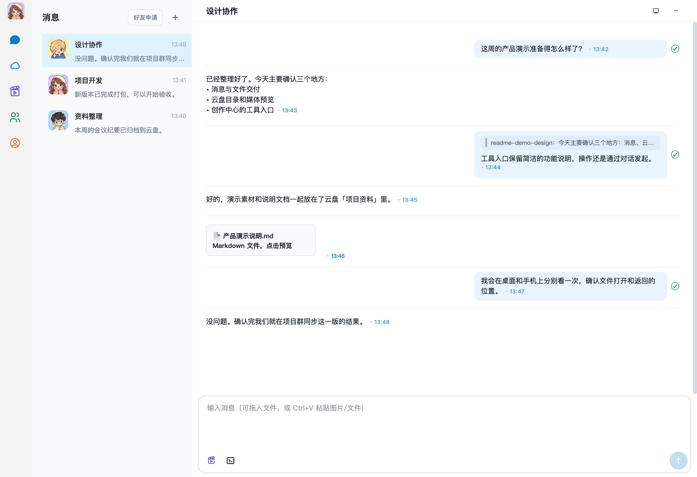
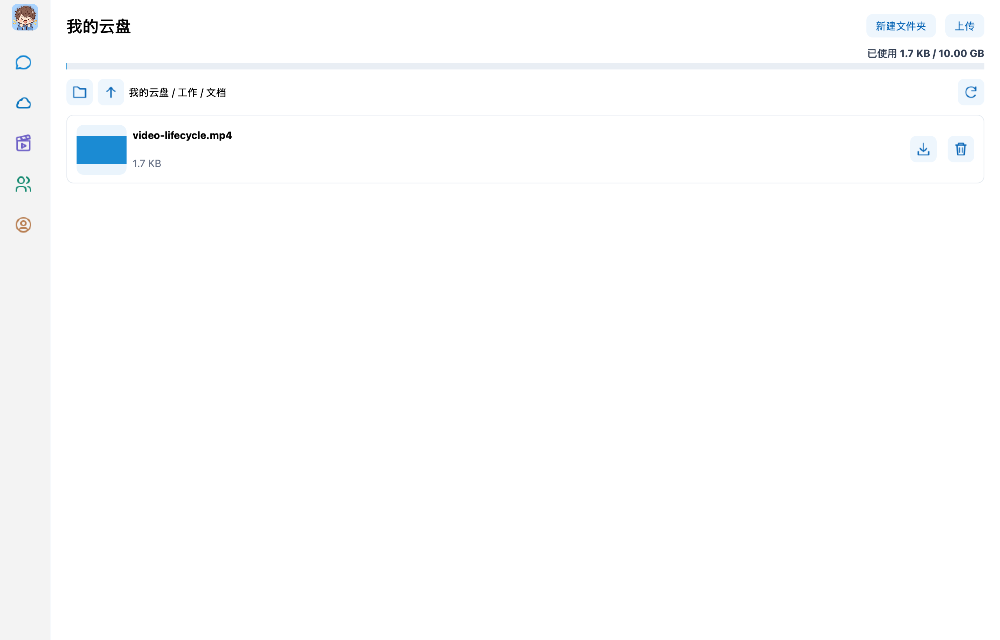
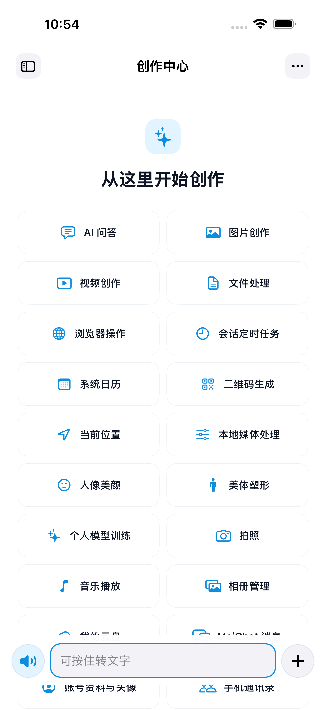

# MaiChat

MaiChat 包含 iOS、Android 和 Qt 桌面客户端，以及账号、云盘和临时凭据等配套服务。

## 运行截图

以下为真实产品控件的运行截图，使用本地示例会话和测试素材；iOS 来自模拟器。
点击图片可查看原图。

**macOS：消息、引用与文件（本地示例会话）**

[](docs/screenshots/desktop-messages.png)

<table>
  <tr>
    <th>macOS：我的云盘</th>
    <th>iOS：创作中心</th>
  </tr>
  <tr>
    <td valign="top"><a href="docs/screenshots/desktop-cloud-drive.png"></a></td>
    <td valign="top"><a href="docs/screenshots/ios-creation-center.png"></a></td>
  </tr>
</table>

截图的构建来源和原图校验值见[运行截图记录](docs/diagnostics/maichat-readme-screenshots-20261103.md)。

## 仓库结构

- `MaiChat/`：各端客户端、共享网络和媒体代码。先阅读 `MaiChat/AGENTS.md`。
- `MaiAgent/`：跨平台 C++ Agent 核心、第三方源码、模型和构建脚本。先阅读 `MaiAgent/CLAUDE.md` 和 `MaiAgent/docs/CodingStyle.md`。
- `services/`：账号、会话同步、云盘素材签名、模型凭据、法律文档与服务集成测试。各服务使用各自目录的 README 和环境变量配置。
- `docs/`：设计、排障与验收记录。

这些目录的相对位置是当前构建和服务测试的约定：`MaiChat/desktop` 和 `MaiChat/MobileAgentAdapter` 从相邻的 `MaiAgent/` 读取核心和第三方源码；服务测试也使用 `services/` 内各目录之间的相对路径。

## 构建准备

需要匹配目标平台的 Xcode、Android SDK/NDK 或 Qt，以及项目构建脚本要求的 CMake、Ninja 和其他工具。第三方许可证与构建产物需按各端脚本携带。部分模型和平台依赖不是仓库内的生成产物，需要按对应的 `MaiAgent/scripts/` 和平台脚本准备；例如 iOS 构建要求先按 `MaiAgent/scripts/fetch-lama-model.sh` 准备 LaMa 模型。不要将本机缓存、签名材料或服务端凭据提交到仓库。

### iOS

在 `MaiChat/ios/MaiChat/` 打开 `MaiChat.xcworkspace`，选择 `MaiChat` scheme。构建阶段会通过 `scripts/build-mobile-agent.sh` 构建 C++ 依赖。真机需要本机有效的 Apple 开发签名、已注册设备及相应权限；签名配置应以当前开发环境为准。

### Android

在 `MaiChat/android/MaiChat/` 使用 Gradle wrapper。Android SDK/NDK 路径保留在本机配置中；先查阅该目录的 Gradle 配置与构建脚本，再按目标设备构建和验证。

### 桌面端

Qt 目标由 `MaiChat/desktop/CMakeLists.txt` 配置。macOS 打包入口为 `MaiChat/desktop/scripts/package-macos.sh`；Windows 打包、依赖检查和运行时验证入口位于同一 `scripts/` 目录。应先准备匹配的 Qt 和平台依赖，按脚本说明构建和检查，不把仅完成编译当成完整包验收。

## VS Code C++ 索引

在仓库根目录打开 VS Code。根目录的 `compile_commands.json` 汇集真实桌面、MaiAgent
和移动端构建命令，clangd 使用 `.clangd` 中的统一入口；本机 VS Code 配置同时指定了
C/C++ 扩展的数据库位置，并隐藏构建、缓存、日志和临时目录。生成文件不提交到仓库。

首次提供已有构建导出的数据库，顺序决定同一源文件优先使用哪套平台选项：

```bash
python3 MaiChat/scripts/generate-workspace-compile-commands.py \
  --database <desktop-build>/compile_commands.json \
  --database <agent-build>/compile_commands.json \
  --database <mobile-build>/compile_commands.json \
  --ios-fragments .cache/cpp-index/ios-fragments
```

输入位置会保存在本机 `.cache/cpp-index/inputs.json`。新增 C++ 源文件或调整 CMake 后，
运行以下命令刷新已有构建配置与索引数据库，无需重新编译产品：

```bash
python3 MaiChat/scripts/generate-workspace-compile-commands.py --refresh
```

iOS Xcode 专有源文件通过 Clang 的 `-gen-cdb-fragment-path` 构建选项导出真实命令，
片段目录沿用上述 `--ios-fragments`；修改 Xcode 编译选项后重新导出片段再运行汇集脚本。
旧子目录数据库会替换为指向根数据库的相对链接，避免编辑器继续读取拆仓前的路径。

## iOS Swift 测试代码

正式页面和模型仍在 `MaiChat/ios/MaiChat/MaiChat/` 原有功能目录中。App 内的测试宿主、
假会话、生成素材和本机验收逻辑集中在其中的 `DebugSupport/`，只在 Debug 编译，
正式代码仅保留需要访问私有状态的短接入点。XCTest 断言和操作脚本继续放在同级
`MaiChatUITests/` 独立 target；共享 scheme 的 Test 使用 Debug，正常 Run 使用 Release。

## 服务与凭据

账号资料工具：`maichat_get_current_account` 读取当前登录账号的本机资料快照，返回公开
MaiChat ID、IM ID、昵称、脱敏手机号及稳定头像地址；离线不等于退出，未知字段为 null。
其中 `account_id` 对应「我 → 个人资料 → 账号」，用于添加好友；`im_user_id` 是内部聊天标识。
`maichat_set_avatar` 接受 Agent 可访问的本地图片，规范化为 512×512 JPEG，经现有
签名服务和客户端 OSS 直传后等待 IM 确认。它与普通头像服务共用实现，原图保留；
昵称修改和安全密码入口继续使用已有工具。创作中心的能力列表仍是不可点击的说明。

`services/auth`、`services/oss-media-signer`、`services/model-credentials`、`services/shared` 和 `services/integration` 共同实现并验证账号、素材及凭据流程，`services/legal` 提供法律文档。实际部署、证书、密钥、数据库和用户数据位于部署环境，迁移源码本身不会迁移或重启线上服务。发布或部署前分别阅读各服务的 README，验证环境配置、访问权限和已有客户端兼容性。

模型和媒体请求由客户端直接访问供应商；服务端只承担账号鉴权、配置和临时凭据等控制面职责。长期密钥保存在服务端受控环境中，不写入客户端源码、安装包或日志。

## 验收

按 `MaiChat/AGENTS.md` 在目标平台和实际交付构建上验证；构建、自动测试与真机验收各自记录结果。未连接的设备或未运行的路径应明确标注。
