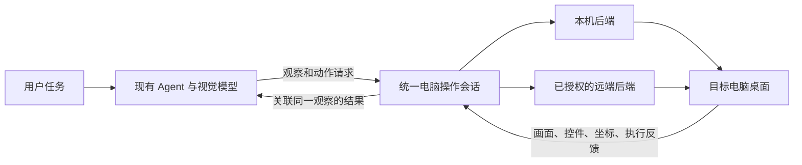

# 大模型操作整台电脑：能力审计

## 目标与本次范围

用户明确的目标是：大模型充当操作者，自己观察电脑画面、决定下一步、执行鼠标键盘动作，
根据新画面继续操作，最终完成用户任务。打开软件、浏览器操作只是例子，不能把需求缩成
两个专用功能。北京操作者经远控操作纽约电脑的类比，描述的是通用电脑操作范围；
实际承担观察与决策的是模型，不要求用户逐步点击。

审计日期：2026-11-10，Asia/Shanghai。源码基线：
`28977e7a42e5bbb680505e5aa7c8aef9ebe0b240`，MaiChat tree
`75f496917b9a88dc9d09ad025da198eb8eaef93f`，Core tree
`463d7c57022f06159824563d38b41f6de5ab62b1`。

本轮为源码、已有日志与验收记录的只读审计；未启动模型、浏览器或远控，未注入键鼠，
未连接实际账号或设备，未构建或替换安装包。以下“已实现”不等于“实机任务已通过”。

## 结论

已有屏幕采集、UIA/AX 观察、系统键鼠、Agent 多轮工具调用、图像回灌和人工远控基础。
但 `DesktopComputerController` 当前以已观察的单个普通窗口为操作目标，尚未组成覆盖
整台电脑的统一观察、坐标、输入、反馈与控制会话。不能据此宣称已实现通用电脑操作。

主要缺口是：

1. 模型可操作的完整桌面目标，包含桌面、任务栏/Dock、菜单、新应用与跨进程对话框。
2. 绑定同一目标电脑、显示器、画面和坐标变换的观察与动作契约。
3. 通用输入原语及跨动作按键状态，而不只是一组受单窗口约束的编辑动作。
4. 操作后观察、界面等待、异常恢复和任务结果验证的统一执行流程。
5. 普通电脑操作与已有浏览器会话的衔接；浏览器专用接口本身也不完整。
6. 模型直接使用远控画面/输入后端的接线，以及准确的输入执行回执。
7. 实际模型驱动真实应用的端到端验收。

## 当前能力与具体缺口

| 范围 | 当前实现 | 缺少或尚未验证的能力 | 源码依据 |
| --- | --- | --- | --- |
| 启动与发现应用 | 枚举部分可见窗口；`DesktopProcessManager` 可运行持久 shell | 不是已安装应用目录；缺少应用启动、激活及启动 PID 到窗口关联的一体流程与回执。可用开始菜单/Dock 完成启动，但当前整桌面输入目标尚不完整 | `DesktopComputerWindows.cpp:368`；`DesktopComputerMac.mm:497`；`DesktopProcessTools.cpp:83`、`:369` |
| 桌面与系统界面 | 可选择普通窗口；可识别部分有明确归属的菜单、sheet | 无统一 desktop/display target。枚举过滤无标题、最小化、小窗口或非普通层；点击还受选中窗口归属约束，不能视为覆盖任务栏、Dock、全局菜单和任意系统弹窗 | `DesktopComputerTools.cpp:343`、`:419`；`DesktopComputerWindows.cpp:183`、`:374`；`DesktopComputerMac.mm:503` |
| 鼠标和键盘 | 点击、双击、右键、直线拖拽、文本、快捷键、滚轮、聚焦 | 模型入口无独立移动、按钮/按键按下与释放、长按、跨调用保持、中键、水平滚动等；拖拽仅允许 1–200ms，滚轮以有限行数表达 | `DesktopComputerPlatform.h:30`；`DesktopComputerTools.cpp:321`、`:339`、`:475` |
| 跨窗与多屏 | 重新枚举/观察可换普通窗口；已有物理坐标与 DPI 处理 | 截图只选鼠标所在显示器，模型不能列出/指定显示器；回执缺显示器原点、缩放、旋转和统一坐标变换。跨窗拖放与新弹窗没有统一目标转换流程 | `MaiScreenshotTool.cpp:32`、`:196`；`DesktopComputerWindows.cpp:45`；`DesktopComputerTools.cpp:419` |
| 文本和剪贴板 | Unicode 输入与常见编辑组合键 | 不等于输入法组合与候选选择；无通用剪贴板格式、读写、归属和恢复接口。发送 Ctrl+C/V 不证明目标内容已正确转移 | `DesktopComputerWindows.cpp:249`；`DesktopComputerMac.mm:448`；`DesktopComputerKeys.cpp:30` |
| 观察与图像 | 常驻 WGC/ScreenCaptureKit；截图图片可回灌模型；UIA/AX 控件信息 | screenshot 只有尺寸、帧号和时间；computer.observe 在模型入口仅给窗口元数据，不截窗口图。两者没有共享观察标识，图片本身也未绑定 tool call/window snapshot。控件树不是完整视觉环境 | `MaiScreenshotTool.cpp:192`；`DesktopComputerTools.cpp:531`；`MaiTurnRunner.cpp:704`；`MaiContextBuilder.cpp:236` |
| 浏览器 | 专用工具有 open/observe/screenshot/click/type/close、URL/元素/快照校验 | open 创建临时 profile，不接管既有登录窗口；无 attach、标签页管理、按键、既有会话内独立 navigate/back/forward/reload 和等待接口。DOM 点击/赋值不覆盖所有网页及原生浏览器对话框 | `DesktopBrowserTools.h:18`；`DesktopBrowserTools.cpp:342`、`:467`、`:559` |
| 操作反馈 | 有 dispatched/verified 区分；可比对焦点非安全输入框文本 | 输入派发不等于业务完成；焦点文本匹配也不证明保存或提交。缺通用视觉条件等待、操作后的新观察与任务完成证据要求 | `DesktopComputerTools.cpp:369`、`:615`；`DesktopBrowserTools.cpp:650` |
| Agent 循环 | 默认最多 64 轮；重复相同调用/结果三次后收尾；错误、图像回灌；取消、审批、steer 和历史持久化 | 不应称为“没有循环”。缺的是电脑操作特有的等待、进度、恢复检查点和接管流程；模型主动选择验证不能替代执行层的结果契约 | `MaiAgent.h:210`；`MaiTurnRunner.cpp:332`；`MaiContextBuilder.cpp:236` |
| 模型能力 | 工具按模型过滤；截图有图像附件传输路径 | screenshot 和 browser screenshot 对 `local:` 的视觉可用性判断不一致；缺统一能力声明。脚本模型的图像链测试不证明实际所选模型能理解界面 | `MaiScreenshotTool.cpp:45`；`DesktopBrowserTools.cpp:619` |

### 当前不能混为一谈的几件事

- 有进程工具，不等于已有可靠的 GUI 应用启动/激活流程。当前 owned shell/job 的结束清理
  也不能直接作为用户应用的生命周期策略。
- 有截图，不等于动作使用了这张图对应的目标屏幕、坐标或最新界面。
- 有 UIA/AX，不等于能覆盖画布、游戏、图片按钮或自绘界面；通用画面操作必须可独立成立。
- 有窗口保护，不等于应该让所有动作只能在那个窗口里。应在完整电脑会话中表达目标与
  用户授权，保留过期观察检查，同时支持有意的焦点与窗口转换。
- 浏览器 CDP 是可选的精确执行通道，不应成为操作已有浏览器的前提。即使不能 attach，
  完整屏幕/键鼠能力也应该能像用户一样操作地址栏、标签页和文件选择框。

## 已有远控可复用什么

`remote/RemoteInputProtocol.h:60` 已定义屏幕归一化坐标、鼠标移动/按钮/滚轮、
物理键按下/释放、Unicode 文本和 ReleaseAll。Sender/Injector 已有会话序号、可靠性分流、
限流、按住键追踪、结束会话及静默超时释放。相比现有模型工具，原语更完整。
TRTC、授权状态机、捕获几何和人工控制 UI 都是已有资产，无需新写一套远控软件。

但当前两条链没有形成同一个模型执行后端：

- `DesktopComputerBackend` 默认绑定本机原生实现，工具不接受目标设备或远控会话。
- `ITrtcEngine` 向上提供画面可用性、尺寸和原生 view 绑定，未给 Agent 提供远端像素帧
  的普通观察接口；人能看到远端画面，不代表模型已经收到图像。
- `maichat_remote_session_*` 工具管理的是另一台设备上的聊天 Session；不执行 TRTC
  屏幕动作。现有远端 Session UI 可以把任务交给目标机 Agent，让它在目标机本地执行；
  这与一个 Agent 直接观察并控制远端桌面是不同部署方式。
- `IRemoteInputSink` 的注入方法返回 void，Windows 多处 `SendInput` 返回值未核对。
  接收器接受包或 SDK 接受发送，不证明操作系统已成功插入输入，更不证明应用处理了它。
- 远端 Sender 对超过单包 1 KiB 的单条文本事件直接丢弃，没有文本分片与执行失败回执。
  已有输入协议的文本类型不能直接等同于可靠的大段文字输入。
- 现有输入几何主要围绕一块采集屏幕，不能直接当作完整多屏桌面契约。
- 结束会话和静默释放不等于完整断线恢复。TRTC `onExitRoom` 当前为空；目标重连、
  未决动作是否已执行、旧动作拒绝重放以及模型恢复点都需要明确契约。

依据：`DesktopComputerTools.cpp:58`、`:147`；`DesktopRemoteSessionTools.cpp:23`；
`remote/TrtcEngine.h:67`、`:99`；`remote/RemoteInputInjector.h:32`；
`remote/RemoteInputSink.cpp:42`；`remote/RemoteDesktopController.h:110`；
`remote/RemoteInputSender.cpp:223`；`remote/TrtcEngine.cpp:178`。

## 建议的统一执行关系

这不是新增一个模型或另一套聊天框架。保留现有 Agent/存储/取消/审批、常驻屏幕采集、
Windows/macOS 原生输入与远控传输；补它们之间的普通 C++ 会话接口和模型工具适配。
同一核心能力可由应用直接调用，也可由大模型调用。

建议优先顺序：

1. **整桌面观察与输入**：明确电脑、显示器/桌面、画面标识、时间与坐标变换；支持
   基本鼠标键盘原语、跨窗焦点转换、等待和取消。保持已有模型整屏截图主路径，
   不恢复被移除的模型窗口截图参数。UIA/AX 作为辅助信息。
2. **形成操作反馈流程**：动作回执关联原观察；操作后取得新观察或明确的未变化状态；
   等待界面条件、处理目标消失/弹窗/失焦，区分派发、操作系统执行、效果观察与任务完成。
   暂停、用户接管、取消和失联均需释放本次持有的键鼠状态。
3. **接通已有系统资产**：把远控帧/输入和本机后端接入同一普通接口；补 GUI 应用启动
   与身份回执，扩展现有浏览器 Manager 的会话与导航。应用启动不做成逐 App 特例。
4. **用真实任务验收**：验证跨应用连续操作和环境变化，而非只检查 API 返回值。

这些是审计提出的实施方向，不是本轮已经完成的新实现或已批准的最终接口设计。

## 实机验收应证明什么

验收执行者必须是实际具备视觉能力的模型。人工可以授权或接管，不能替模型完成中间操作。
脚本模型适合先验证执行器和错误路径，但单独使用它不能证明模型自主完成任务。

| 场景 | 应实际看到的结果 |
| --- | --- |
| 从桌面启动已有编辑器 | 模型找到入口、启动/激活应用、输入中英文、处理另存为、保存，再重新打开核对；不手动预先选中编辑框 |
| 操作已有浏览器 | 保留既有测试登录态，使用地址栏/标签页，处理加载及原生文件框；保存后刷新仍能核对结果。使用自有测试站点和账号 |
| 跨应用工作 | 在自有文件/测试应用间复制粘贴、切换窗口、处理菜单与跨进程对话框，目标不串会话 |
| 环境变化 | 混合 DPI/负坐标双屏、窗口移动或最小化、出现弹窗后重新观察，不能沿用旧图误点 |
| 取消与接管 | 拖动或持有组合键时取消/断线，实际键鼠释放；用户接管后模型停止输入，恢复时重新观察 |
| 结果与失败 | 目标关闭、权限不足、受保护桌面或超时给准确状态；发送点击、无异常返回或焦点文本一致都不能冒充任务已完成 |

测试限定自有素材/应用会话，不使用真实业务数据，不为界面验收触发付费模型任务。
后续真实模型功能验证须选用适合并已获授权的模型与环境，逐项记录其与脚本模型验证的区别。

已有记录的边界仍是：确定性 fake Agent 链 17 次调用/结果通过；Windows 三项原生输入
套件因交互前台条件跳过，Mac 原生输入因锁屏未验收。未找到此后将这一完整原生链转为
通过的新证据。后续 Qt6、截图、打包或启动通过均不能补齐它。
见 `maichat-desktop-computer-control-20261107.md:106` 和
`maichat-qt6-source-integration-20261108.md:59`。

## 首次实现与定点回归（2026-11-10）

本节记录相对 `28977e7a42e5bbb680505e5aa7c8aef9ebe0b240` 的未提交工作；
上方能力表是修改前审计，不能作为当前新实现仍不存在的结论。

- 普通 API 与模型工具已共享 `list_displays`、选定显示器观察和整桌面输入。
  继续使用原常驻 WGC/ScreenCaptureKit；坐标绑定原生显示器边界，PNG 像素尺寸单独返回。
  鼠标移动、跨窗口点击/拖动、Unicode 和快捷键不再强制激活先前选定窗口。
- 输入后要求帧序号、接收时间与原生生成时间均越过输入屏障；旧缓存或晚到旧帧不能当作
  新画面。取消同步传至采集；刷新失败保留已派发回执并消费旧 token。
- workspace、显示器身份/几何和全局输入代次参与校验。跨 controller 的实际输入使其他
  display token 失效；输入进行中的观察不发布可操作 token。窗口 focus/click 也使旧屏幕
  观察失效。Mac inactive display 在 TCC 检查之前拒绝，避免负例弹出授权框。
- 普通/适配器新断言先后真实失败 24、13、38 处；并发代次用例 8 处失败后修正。
  追加窗口操作/在途观察边界后全 contracts 通过 0.81 秒。无焦点文本控件的系统启动快捷键
  另有 12 处失败，限定导航例外后同例全 contracts 通过 0.97 秒；文字/粘贴/删除仍校验焦点。
- 实际 Agent/ContextBuilder/工具调用链中，脚本模型完成 5 次显示器操作调用，后续请求
  收到 4 张测试 PNG；和原窗口例合计 4PASS/0FAIL/0SKIP。后端为 RecordingBackend，
  不采集、不注入、不联网，不能称为真实模型的视觉任务验收。
- 最终 Core 实现正常构建后，请求 validation-only exit0；9 组 Core 回归全部通过，
  94.48 秒。原始日志在 `.cache/computer-use-20261110/core-final-*`。
- Mac 首14快照正常 App/contracts 已链接、registered contracts 1/1 通过 1.30 秒；
  此证据早于最新帧屏障/代次修正。第2快照15文件已逐项传递供必要增量，不把首轮结果
  倒填为新快照通过。原生输入与实际视觉模型任务仍需独立证据。

Windows 新增 opt-in 自有双进程全屏编辑器测试用于实际显示器采集/输入/新帧与独立读回。
默认跳过；前台不属于测试、物理输入正按住或显示器未由测试窗口覆盖时不输入。
任何真实动作开始后的失败均不降为环境跳过。它同样不宣称模型自主决策已验证。

实际执行又定位一项 WGC 边界：同例最初点击已派发，但后续新帧 2 秒超时；定点原生日志
看到 compositor 的原始 `SystemRelativeTime` 比读取时 QPC 提前约 2–3ms。初次换算为未知值后
不再复核，会使后续帧一直无法满足屏障。修正保留原始 QPC，在时钟赶上后重新换算，且先核
候选再 drain，防止高帧率覆盖；接收时间和源时间均未改写，未知或仍在未来的时间不能通过。
临时 printf 已移除，原失败和定点日志均在本地证据目录。

修正后同一原生用例最终 1/1PASS，1.58 秒；owned child PID32040，实际中文与 Enter 确认、
UIA 独立文本读回均符合；`worker_starts=1/session_starts=1/frames_received=7`，四次观察
复用了同一常驻采集会话。四张自有窗口 PNG 已逐张查看，最后画面显示输入及确认内容。
刚产生的新帧仍可能先于应用处理输入，因此增补 `observe.wait_ms=0..5000` 可取消等待，
模型应等待/再观察后判断效果，不能根据派发回执盲目重复输入。

最终 normal App/三个电脑测试目标构建 exit0，自动部署核对 3 binaries/114PE imports/plugins。
contracts 通过 0.98 秒；原/新脚本 Agent 链 4PASS/0FAIL/0SKIP，779ms。最终 QPC 源重建后
validation-only exit0，9 组 Core 通过 156.05 秒；先前 94.48 秒是此修正之前的历史记录。
Mac 第3快照正常 App/contracts 构建 exit0，registered contracts 1/1 通过 1.00 秒，仍无 OS 采集/输入。
Windows 后续普通执行器已完成原生 Save As、独立磁盘读回、清空与 Open/reopen，两个真实文件
对话框和最终 UIA 内容均验证，一条 resident worker/session；具体原始失败与最终结果见
`maichat-computer-use-document-workflow-20261110.md`。随后同一普通执行入口在独立 Chrome 配置中完成
原生地址栏两页导航，服务端 Cookie、UIA 地址和正文均独立验证，进程及临时配置已清理；详见
`maichat-computer-use-browser-workflow-20261110.md`。这些不替代视觉模型决策验收。真实视觉模型调用尚未执行，已询问用户
用于最终自有编辑器/浏览器验收的模型；没有读取其凭据或为 UI 测试发起付费请求。

## 对照资料（外部依据）

模型提供动作决策，宿主仍须实现观察、动作和工具结果循环；可参考官方
[computer-use 宿主循环说明](https://platform.claude.com/docs/en/agents-and-tools/tool-use/computer-use-tool)。
这不是要求切换到该供应商，现有 Agent 接口仍应保持可复用。

Windows 输入的返回值与完整性级别边界按
[Microsoft SendInput 文档](https://learn.microsoft.com/windows/win32/api/winuser/nf-winuser-sendinput)
解释：返回值不直接说明失败是否由 UIPI 引起。当前没有已验收的高权限/安全桌面控制后端，
应明确其能力边界，不宣称可覆盖任意系统界面。
